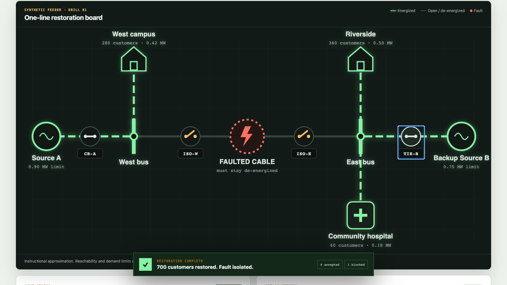

# Restoration Lab

Restoration Lab is an interactive switching drill for junior distribution engineers. A synthetic cable fault has interrupted 700 customers and a community hospital. The trainee has to isolate the fault, restore the healthy sections and avoid backfeed or an overloaded source.

**[Open the live interactive demo](https://abhinav0905.github.io/restoration-lab/)**

The main idea is simple: check every proposed switch action before it changes the network. Unsafe moves are rejected with a plain-language reason and a visible path on the one-line diagram.



## Why this project is different

Most learning material turns restoration into a diagram to memorize. This prototype makes the order of operations interactive. Closing Source A too early is blocked. The fault path flashes red. Open both isolators, then the same source close becomes safe.

The safety gate checks four things:

- whether either source can reach the faulted cable;
- whether two sources would feed the same section;
- whether restored demand exceeds a source's drill limit;
- whether the community hospital is energized in the final state.

All data is synthetic. The model is intentionally small and deterministic so a learner can inspect why an action passed or failed. This is not an operational switching tool and does not calculate AC power flow.

## Try it

Use the [live GitHub Pages app](https://abhinav0905.github.io/restoration-lab/), or run it locally.

Requires Node.js 20 or newer.

```bash
npm install
npm run dev
```

Open `http://127.0.0.1:5173`. You can operate the four switches yourself or press **Watch demo** to see one blocked attempt followed by the safe four-action sequence.

The safe sequence is:

1. Open `ISO-W`.
2. Open `ISO-E`.
3. Close `CB-A` to restore West campus.
4. Close `TIE-B` to restore Riverside and the hospital.

## Verify it

```bash
npm run verify
```

That command runs six graph-engine tests, builds the production bundle and runs four browser tests. The browser suite checks the judge-first explanation, blocked action, safe restoration and timed Watch demo path.

## Project map

- `src/data/scenario.ts` defines the fixed feeder, loads, capacities and switches.
- `src/lib/gridEngine.ts` builds the graph, traces source reachability and returns safety findings.
- `src/hooks/useRestorationLab.ts` applies accepted actions and records the switching timeline.
- `src/components/OneLineDiagram.tsx` draws the interactive SVG one-line board.
- `devpost/` contains the approved scope, PRD, technical plan, build checklist and code tour.
- `video/` contains the Remotion source for the 84-second narrated demo.
- `docs/restoration-lab-demo.srt` contains upload-ready captions.

For a guided source tour, open [`devpost/app-map.html`](devpost/app-map.html) in a browser.

## Built for Build With AI: Basics

The project was planned and built with the required `challengepost/learn-ai-basics` skill pack. The repository keeps the scope, PRD, spec and checklist beside the working code so the build decisions can be checked against the result.

## License

MIT. See [LICENSE](LICENSE).
